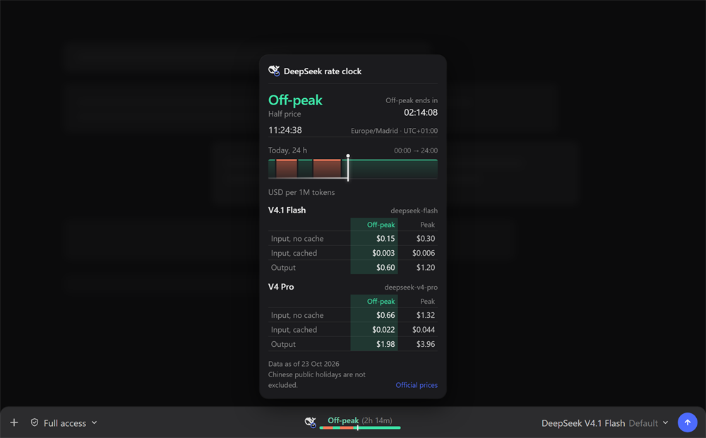
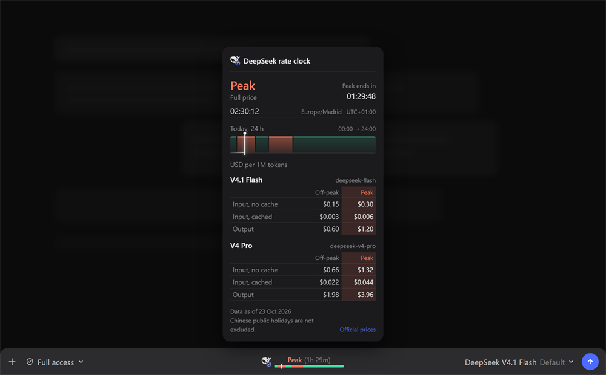

# dsh-deepseek-peakoffpeak

[](https://www.npmjs.com/package/@jamolpe88/dsh-deepseek-peakoffpeak)
[](https://www.npmjs.com/package/@jamolpe88/dsh-deepseek-peakoffpeak)
[](https://github.com/JaMoLpE88/dsh-deepseek-peakoffpeak/releases)
[](LICENSE)
[](#compatibility)
[](#compatibility)
[](https://dsh-plugin.org/plugins/jamolpe88/dsh-deepseek-peakoffpeak)

**DeepSeek peak/off-peak rate clock in the DeepSeek Harness composer.** A live 24-hour tariff bar lives in a compact pill between the permission and model controls; click it for a DSH-style window with the current band, the countdown to the next change, the day's windows and the official prices per million tokens.

Zero configuration. The plugin is computed in the browser from the user's clock and the official price table — no API, no key, no settings page.

**Español** → [README.es.md](README.es.md)

**Project page** → [jmolo.es/proyectos/dsh-deepseek-peakoffpeak](https://jmolo.es/proyectos/dsh-deepseek-peakoffpeak/)



*The details window: the active band with its half-price / full-price note, the countdown to the next change, the current local time and zone, today's 24-hour bar, and the official prices for V4.1 Flash and V4 Pro with the active column tinted.*



*During peak the same window turns warm: the band, the 24-hour bar and the active price column follow the peak color.*


*The compact pill: the DeepSeek mark with a small clock, the current band, the time left and a 24-hour bar with the peak / off-peak blocks and the current-time marker. It is visible only with a DeepSeek model.*

## What it does

- Shows a **live 24-hour tariff bar** in the composer: peak and off-peak blocks for the user's local day, plus a marker for the current time.
- Labels the active band (`Peak` / `Off-peak`) and the **time remaining** to the next change, updated every second.
- Opens a DSH-style details window on click:
  - the active band with `Full price` / `Half price`;
  - a `hh:mm:ss` countdown to the next change;
  - the current local time, time zone and UTC offset;
  - today's 24-hour bar with its segments, progress line and now marker;
  - the official USD price per 1M tokens for **V4.1 Flash** and **V4 Pro** (input without cache, input with cache, output), with the active column tinted green for off-peak and warm for peak;
  - the official source link, the data date and the Chinese-holiday note.
- Appears for **DeepSeek models from any provider**: `deepseek-official`, `deepseek-account`, `opencode-go` with a DeepSeek model, or an aggregator whose provider, model id or catalog name contains `deepseek`.
- Appears on a new, empty Session before the first prompt, following the model the composer displays.
- Joins the **centered pill group** shared with the other JaMoLpE88 composer plugins: with more than one pill visible they sit side by side, centered, with a small gap; they hide together when the row runs out of room.
- Updates by itself from the user's real clock; no server, no polling.

## What it does not do

- It does not call the DeepSeek API and does not read credentials.
- It does not ask for a key or store one in the plugin.
- It does not exclude Chinese public holidays; the official peak note excludes them and this plugin does not ship a holiday calendar.
- It does not update prices by itself: the table is shipped with the plugin and the window shows the data date.
- It does not keep history, charts, telemetry or local storage.
- It does not add tools, commands or changes to the agent.
- It does not show anything when the active model is not a DeepSeek model.

## Why there are no settings

Everything the plugin needs is already on the machine: the user's clock and the official price table. There is no key to enter, no endpoint to configure, no refresh interval to choose and no threshold to edit. The only visible state is the band, the countdown and the prices; when the model is not DeepSeek there is nothing useful to show and the plugin renders nothing.

## Requirements

- **DSH Desktop** `>= 0.2.1-rc.3`, profile `desktop` (tested on `0.2.1-rc.3`, Windows 11).
- A **DeepSeek model** selected from any provider: `deepseek-official`, `deepseek-account`, `opencode-go` with a DeepSeek model, or an aggregator that serves one.
- Node 22+ (DSH ships its own runtime).

If no DeepSeek model is available, the plugin never appears. That is intentional.

## Install

From npm:

```bash
dsh plugin --profile desktop add @jamolpe88/dsh-deepseek-peakoffpeak
```

From the repository:

```bash
dsh plugin --profile desktop add github:JaMoLpE88/dsh-deepseek-peakoffpeak
```

From a local checkout, while developing:

```bash
dsh plugin --profile desktop add C:\path\to\dsh-deepseek-peakoffpeak
```

Refresh the DSH window after installing. The pill appears in the composer of any session whose active model is a DeepSeek one.

## Usage

1. Select a DeepSeek model, from whichever provider serves it.
2. The pill appears centered in the composer row, between the permission control and the model selector.
3. Read the band and the time left at a glance; the bar paints today's peak and off-peak windows.
4. Click the pill to open the details window with the countdown, the day's bar and the price tables.
5. Click outside the window, press **Escape**, or click the pill again to close it.

The 24-hour bar follows the local day, including days with a daylight-saving change. Times are shown in the browser's local time zone; the peak windows themselves are defined in UTC.

## How it works

- **Peak windows:** `01:00–04:00` and `06:00–10:00` UTC, Monday through Friday. Every other hour is off-peak, including weekends in full.
- The local day (`00:00 → 24:00`) is split at every UTC window boundary, so each block has its real duration and the bar stays correct across DST changes.
- The current instant maps to a position in that local day; the marker and the progress line move every second.
- The countdown is the distance to the next boundary; `Peak` / `Off-peak` is evaluated from the same UTC rules.
- Visibility combines the live `modelSelection` projection with the composer's displayed model, so a blank Session follows the catalog default instead of waiting for the first request.
- The price table is static, transcribed from the official pricing page:

| Model | Concept | Off-peak | Peak |
|---|---|---|---|
| **V4.1 Flash** (`deepseek-flash`) | Input, no cache | $0.15 | $0.30 |
| | Input, cached | $0.003 | $0.006 |
| | Output | $0.60 | $1.20 |
| **V4 Pro** (`deepseek-v4-pro`) | Input, no cache | $0.66 | $1.32 |
| | Input, cached | $0.022 | $0.044 |
| | Output | $1.98 | $3.96 |

Source: [api-docs.deepseek.com/quick_start/pricing](https://api-docs.deepseek.com/quick_start/pricing) (data as of 23 Oct 2026). Off-peak rates are half of the peak rates; Chinese public holidays are not excluded by this plugin.

## Compatibility

| | |
|---|---|
| DSH | `>= 0.2.1-rc.3` (the only version tested by the author) |
| Node | `>= 22` |
| OS | Windows 11 (tested); macOS and Linux untested |
| Profile | `desktop` |
| Models | Any DeepSeek model, from any provider |
| Catalog | [listed on dsh-plugin.org](https://dsh-plugin.org/plugins/jamolpe88/dsh-deepseek-peakoffpeak) |
| Project page | [jmolo.es/proyectos/dsh-deepseek-peakoffpeak](https://jmolo.es/proyectos/dsh-deepseek-peakoffpeak/) |

Validation status: **tested on Windows 11 with DSH Desktop 0.2.1-rc.3** (2026-10-27). The pill appears with a DeepSeek model, paints the peak/off-peak blocks with the current-time marker, shows the countdown and opens the details window with the tinted price column. Not validated: macOS, Linux, other DSH versions and the web profile.

## Limits

- **Chinese public holidays are not excluded.** The official off-peak definition excludes them; this plugin does not ship that calendar. The details window says so.
- **Prices are static.** If DeepSeek changes them, a new plugin version is required; the window always shows the shipped data date.
- **Model detection is name-based.** A provider that serves DeepSeek under an alias with no `deepseek` in the provider, model id or catalog name will not show the pill.
- **The centered group hides when it does not fit.** With several pills visible on a narrow window, the whole group disappears instead of overlapping the model selector.
- **Windows 11 is the only tested platform.**
- **No settings.** No refresh interval, threshold, holiday calendar or price override.

## Privacy

- No network requests: the plugin is computed entirely in the browser.
- No credentials, cookies, session data or workspace IDs.
- No configuration file, local storage or telemetry.
- The screenshots use a simulated chat background; no real conversation is shown.

See [SECURITY.md](SECURITY.md) for the short policy.

## Troubleshooting

**The pill does not appear.**
Check that the active model is a DeepSeek model from any provider. A provider alias without `deepseek` in the provider, model id or catalog name is not detected.

**The prices are out of date.**
The table ships with the plugin. Install the latest version; the window shows the data date next to the source link.

**The counts look wrong.**
The windows are defined in UTC. Check the system clock and the browser's time zone; the window shows both the local time and the UTC offset it is using.

**Several pills disappear at once.**
They share one centered group and hide together when the composer is too narrow. Widen the window to bring them back.

## Development

```bash
npm test        # node --test
npm run check   # syntax check for the Host and Client files
```

The tests cover the UTC peak edges, the next-change search, the day segmentation (including a DST day), the DeepSeek match and the price table. The Client half is a plain `client.js` bundle (no build step) and is verified in the running Harness.

Local install:

```bash
dsh plugin --profile desktop add C:\path\to\dsh-deepseek-peakoffpeak
```

## Third-party marks

DeepSeek and the DeepSeek logo are trademarks of DeepSeek, Inc. The mark is used only to identify the DeepSeek service and its tariffs; it is not covered by the MIT license that applies to the source code. This plugin is independent and unofficial. See [NOTICE](NOTICE).

## License

[MIT](LICENSE) © 2026 JaMoLpE88
